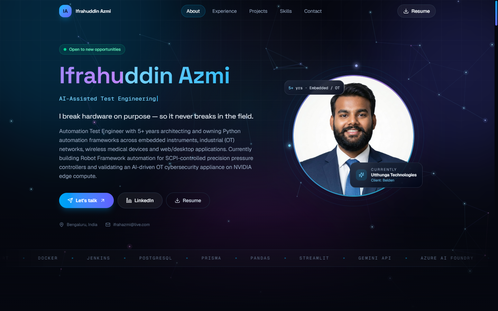
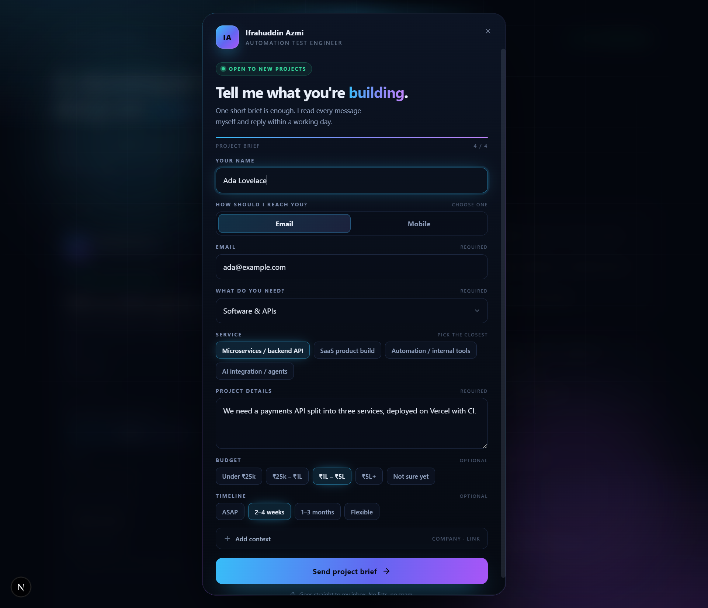
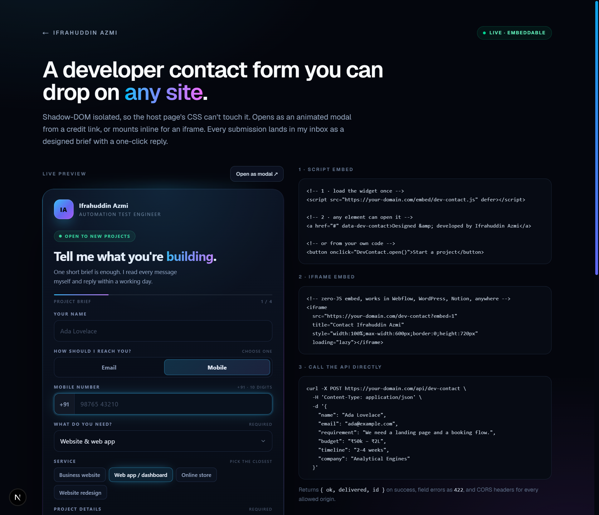
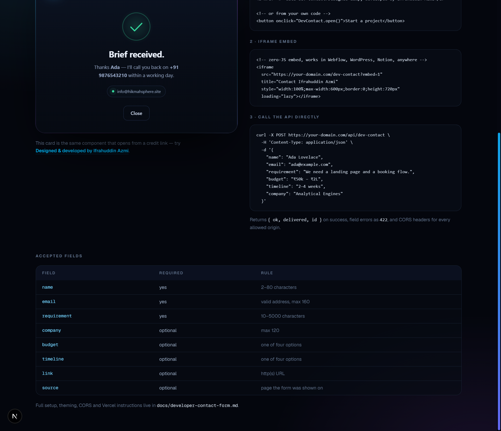

# Ifrahuddin Azmi — Portfolio

A dark, animated one-page portfolio for an automation test engineer — plus two contact
channels that actually deliver mail: a form on the site itself, and a drop-in widget other
people can install on their own sites.



<p>
  
  
  
  
  
</p>

---

## What's in here

**1. The portfolio** (`/`) — hero with live "signal monitor" animation, experience
timeline, selected projects, skills, and a contact section. Everything renders from
[`src/components/portfolio/data.ts`](src/components/portfolio/data.ts), so copy changes
don't require touching layout code.

**2. An embeddable developer contact widget** (`/dev-contact`) — the
"Designed & developed by Ifrahuddin Azmi" credit on a client's site becomes a lead capture
form. Visitors pick a service category, get dependent service options, then choose how to
be reached: email, or a `+91` mobile callback. It ships as one standalone script that other
sites can load with a `<script>` tag.

---

## Tech stack

| Layer      | Choice |
| ---------- | ------ |
| Framework  | Next.js 15.5 (App Router) on React 19 |
| Language   | TypeScript 5, strict |
| Styling    | Tailwind CSS 4, custom aurora/glass design tokens in `globals.css` |
| Motion     | Framer Motion 12 |
| Icons      | lucide-react |
| Email      | Nodemailer 7 over authenticated SMTP (Zoho) |
| Hosting    | Vercel — `bom1` (Mumbai) region |

## Quick start

Requires **Node 20+**.

```bash
npm ci                       # install exactly what the lockfile pins
cp .env.example .env.local   # then fill in the SMTP_* values
npm run dev                  # http://localhost:3000
```

The site renders without SMTP configured; only the contact endpoints need it. Without those
variables they return `502` with a generic message and log the reason server-side.

## Routes

| Route                  | What it is |
| ---------------------- | ---------- |
| `/`                    | The portfolio |
| `/dev-contact`         | Preview / demo page for the widget, with embed snippets |
| `/dev-contact?embed=1` | Same widget, chromeless — meant for an `<iframe>` |
| `POST /api/contact`    | Portfolio contact form (same-origin) |
| `POST /api/dev-contact`| Public widget endpoint (cross-origin, CORS-controlled) |
| `GET /api/health`      | `{ "message": "Good!" }` |

## Environment variables

Set these locally in `.env.local` (gitignored) and in **Vercel → Project → Settings →
Environment Variables** for production.

| Variable | Required | Example | Purpose |
| -------- | -------- | ------- | ------- |
| `SMTP_HOST` | yes | `smtp.zoho.in` | Mail server for your data centre |
| `SMTP_PORT` | no | `465` | Defaults to `465`; `587` also works (STARTTLS) |
| `SMTP_SECURE` | no | `true` | `true` for 465, `false` for 587 |
| `SMTP_USER` | yes | `info@example.com` | SMTP login |
| `SMTP_PASS` | yes | *(app password)* | Use an app password, never the account password |
| `SMTP_FROM` | no | `HikmahSphere <info@example.com>` | Defaults to `SMTP_USER` |
| `SMTP_TO` | yes | `info@example.com` | Inbox that receives notifications |
| `CONTACT_ALLOWED_ORIGINS` | no | `https://client.com` | Comma-separated allowlist for `/api/dev-contact`; `*` (default) accepts any site |

## The site contact form

Posts to `POST /api/contact`, which sends a responsive HTML notification (sender card,
quoted message, and a "where it came from" block with page, referrer, device, IST arrival
time and IP) plus a plain-text fallback. The visitor's address becomes `Reply-To`, so
**Reply** goes straight back to them.

- Validated server-side: name, email, message length; unknown fields ignored.
- Honeypot (`company`) — a filled value returns `200` and sends nothing.
- Rate limited to **4 submissions per IP per 10 minutes**.
- Errors are generic to the client; the SMTP failure code is logged, not echoed.

## The embeddable widget

```html
<!-- once, anywhere on the page -->
<script src="https://your-domain.com/embed/dev-contact.js" defer></script>

<!-- any element opens it -->
<a href="#" data-dev-contact>Designed &amp; developed by Ifrahuddin Azmi</a>

<!-- or from your own code -->
<button onclick="DevContact.open()">Start a project</button>
```

The modal renders inside a Shadow DOM, so the host site's CSS cannot break it. No
framework, no build step, one file.

**Services offered** — eight categories, each with its own dependent options:

| Category | Services |
| -------- | -------- |
| General inquiry | Just a question · Full-time/hiring · Collaboration · Something else |
| Website & web app | Business website · Web app/dashboard · Online store · Redesign |
| Mobile app | Android · iOS · Cross-platform |
| Software & APIs | Microservices/backend · SaaS build · Automation & internal tools · AI integration |
| Design & branding | UI/UX · Logo & identity · Design system |
| Growth & marketing | SEO · Digital marketing/ads · Content & copywriting |
| Cloud & deployment | App deployment/DevOps · Domain, DNS & business email · Performance & security audit |
| Something else | Custom project |

**Contact method is a choice, and the chosen field is mandatory.** Email asks for an
address; Mobile shows a fixed `+91` prefix, accepts digits only, and requires a real Indian
mobile (ten digits, starting 6–9). The API normalises `+919876543210`, `09876543210` and
`98765 43210` to the same number. Phone-only briefs have no `Reply-To`; the notification's
call to action becomes a `tel:` link.





`POST /api/dev-contact` accepts `name`, `category`, `service`, `contactMethod`, exactly one
of `email`/`phone`, `requirement`, and optionally `company`, `budget`, `timeline`, `link`,
`source`. Unknown category/service pairs are rejected with `422`, so the API can't receive a
service the form never offered. It is rate limited to **5 submissions per IP per 10
minutes** and honours `CONTACT_ALLOWED_ORIGINS`.

Full guide — theming, `data-*` options, CORS rules, Vercel steps, troubleshooting:
**[docs/developer-contact-form.md](docs/developer-contact-form.md)**.

## Project structure

```
src/
├── app/
│   ├── page.tsx              # the portfolio
│   ├── dev-contact/          # widget preview + iframe mode
│   └── api/
│       ├── contact/          # portfolio form endpoint
│       ├── dev-contact/      # widget endpoint (CORS + service validation)
│       └── health/
├── components/
│   ├── portfolio/            # hero, about, experience, projects, skills, contact, …
│   └── ui/                   # the few shadcn/ui primitives in use
├── hooks/
└── lib/
    ├── email-template.ts     # HTML + text for the portfolio form
    ├── developer-inquiry.ts  # HTML + text for widget briefs
    ├── mailer.ts             # Nodemailer transport, config, error types
    └── service-catalog.ts    # categories, budgets, timelines, phone validation
public/embed/dev-contact.js   # standalone widget (mirrors service-catalog ids)
docs/developer-contact-form.md
```

## Scripts

| Command | Does |
| ------- | ---- |
| `npm run dev` | Next dev server — the same code path Vercel builds |
| `npm run build` / `npm start` | Production build and server |
| `npm run typecheck` | `tsc --noEmit` |
| `npm run lint` | ESLint (Next config) |
| `npm run deploy` | Push `SMTP_*` to Vercel, then deploy to production |
| `npm run deploy:preview` | Same, but a preview deployment |
| `npm run env:push` | Sync environment variables only |
| `npm run dev:socket` / `start:socket` | Optional Socket.IO echo server (`server.ts`, local only) |

## Deploying to Vercel

1. **Import the repo** at [vercel.com/new](https://vercel.com/new) — the framework is
   detected from [vercel.json](vercel.json), which pins `npm ci` and the `bom1` region.
2. **Add the `SMTP_*` variables** for Production (and Preview if you want form previews to
   send). `CONTACT_ALLOWED_ORIGINS` is optional.
3. **Deploy**, then submit both forms once and confirm the notifications arrive.
4. Attach a custom domain under **Settings → Domains**; HTTPS only works once the domain is
   on the project.

Or from the CLI, with `.env.local` filled in:

```bash
npx vercel login   # once
npm run deploy     # env vars + production deploy
```

Nice properties of this setup:

- `/api/contact` and `/api/dev-contact` are Node.js functions (`runtime = "nodejs"`) —
  Nodemailer needs real TLS sockets, which the Edge runtime doesn't provide. Vercel allows
  outbound 465/587 and blocks 25.
- In serverless the mailer disables connection pooling, so a frozen instance never hands out
  a dead socket; locally it still pools.
- `next build` is the whole build. No custom webpack, no ignored type or lint errors — a red
  build locally is a red build on Vercel.
- Custom `listen()` servers aren't supported on Vercel, which is why `server.ts` is
  local-only.

## Notes and limits

- **Rate limiters are in-memory.** They live inside a warm function instance, so they are a
  speed bump, not a global quota. Validation and the honeypot are what keep the inbox clean.
- **The widget's catalog is mirrored** in `public/embed/dev-contact.js` because it ships
  without a build step. Changing an id in `service-catalog.ts` means changing it in the
  widget too; a parity check against both files is a good habit before releasing.
- **Mail can't be read back** — proof of delivery stops at SMTP acceptance. Check the
  receiving inbox, or the function logs for `EAUTH` / timeouts.

## Licence

[MIT](LICENSE) — the code is yours to reuse. The personal content (résumé, photographs,
project copy) is not; please replace it if you fork this as your own site.

## Contact

**Ifrahuddin Azmi** · Bengaluru, India
[ifrahazmi@live.com](mailto:ifrahazmi@live.com) · [LinkedIn](https://www.linkedin.com/in/ifrahuddin-azmi-8869787a/) · [GitHub](https://github.com/ifrahazmi)
